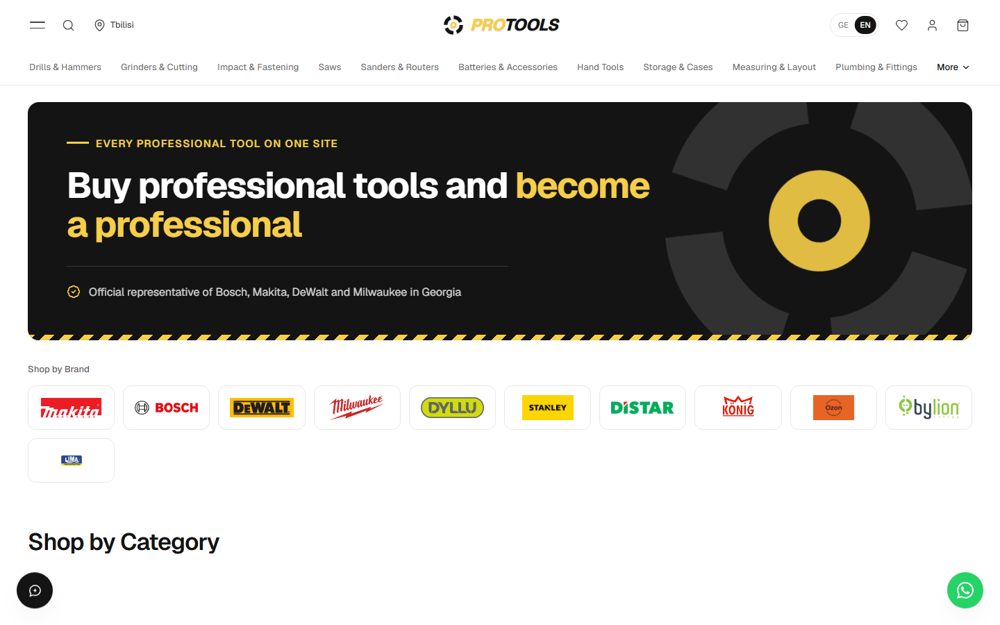
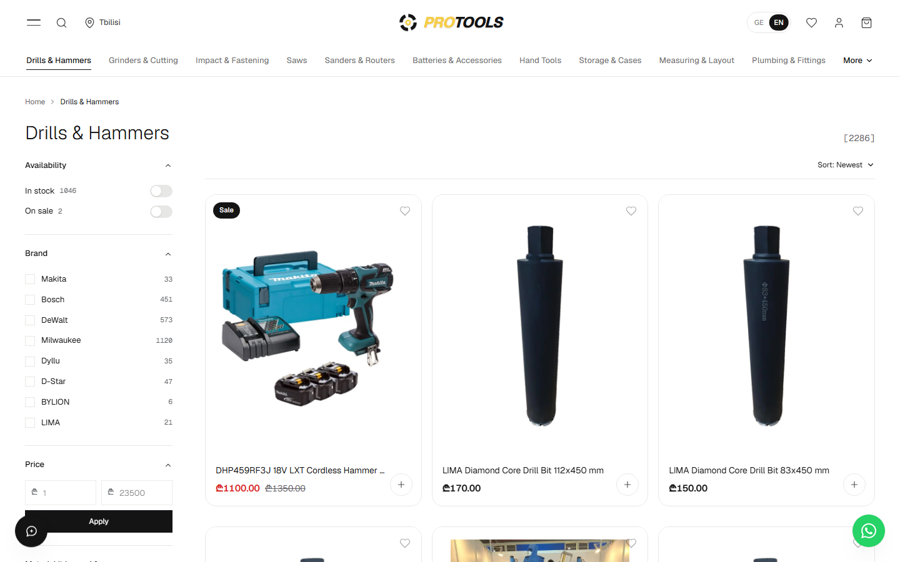
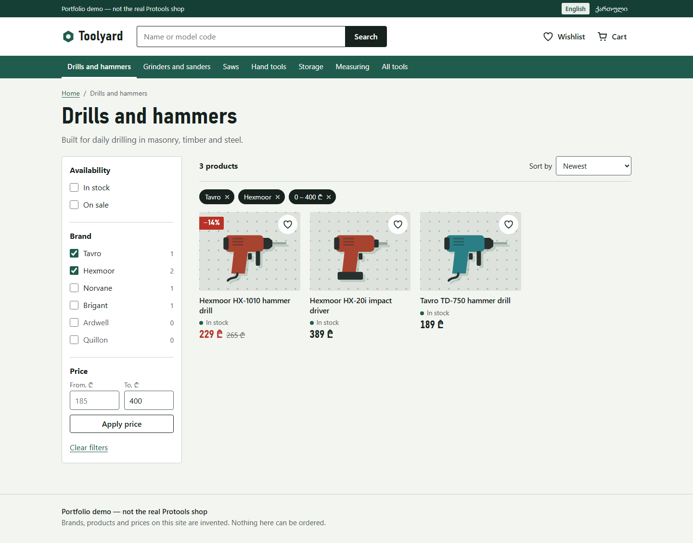
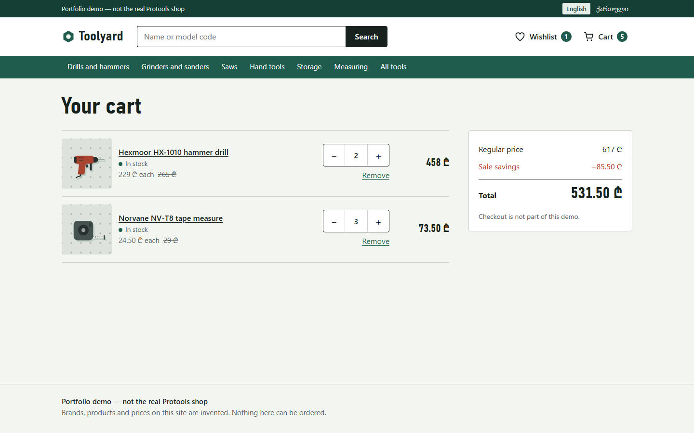

# Protools

Online shop for Protools, a supplier of professional construction tools and equipment in Tbilisi, Georgia.

**Live site:** https://www.protools.ge/ka



I built the original project from scratch at [AllOne](https://github.com/allonelabs). Its source code belongs to the client and is private, so it is not in this repository. What is here is a description of the original project and a separate demo written for this portfolio.

## The original project

### What it does

- **Catalogue.** Thousands of products organised by category (drills and hammers, grinders, saws, hand tools and more) and by brand, including Bosch, Makita, DeWalt and Milwaukee.
- **Filters and sorting.** Each category can be narrowed by availability, sale items, brand and price range.
- **Shopping.** Product pages, cart, wishlist, customer accounts and gift vouchers.
- **Two languages.** Georgian and English.
- **Search and contact.** Site search, a store locator and a WhatsApp button for quick questions.



### How it is built

A Next.js application hosted on Vercel.

## Portfolio demo in this repository

The code in this repository is not the production code. It is a fresh re-creation of the core shopping flow, written for this portfolio. The brands, products, prices, illustrations and text are invented, the visual design is its own, and the back end is mocked with a local sample catalogue. Nothing in it comes from the live site, and nothing in it can be ordered. The demo calls itself Toolyard to keep that clear.



### What it demonstrates

- **Browse, filter, product, cart.** A home page with category and brand entry points, category pages, product pages, a cart and a wishlist.
- **Filters that live in the URL.** In stock, on sale, brand and price range, plus four sort orders. The state is in the query string, for example `/en/category/drills?brand=tavro,hexmoor&max=400`, so a filtered view can be shared and survives a reload. Brand counts follow the other active filters.
- **Search** by product name or model code, in either language.
- **Cart and wishlist** kept in `localStorage`, with quantity changes, removal and a cart badge in the header. Totals are worked out in tetri by a pure function, so sale prices and quantities add up exactly.
- **Two languages.** English and Georgian, switched from the header without losing the current page or filters. UI strings sit in a typed dictionary, so a missing translation is a type error.
- **Tested logic.** Filtering, sorting, counting, query-string parsing, cart totals and money formatting are pure functions in `lib/`, covered by 46 unit tests.
- **Mock API.** `GET /api/products` and `GET /api/products/[id]` are route handlers over the sample catalogue in `lib/catalog-data.ts`. There is no database, no external service and no API key.



More screenshots are in `demo-screenshots/`.

### Run it locally

Requires Node.js 22.18 or newer (the tests run TypeScript files directly with Node's built-in test runner).

```
npm install
npm run dev
```

Then open http://localhost:4821. The other commands:

```
npm test            unit tests
npm run typecheck   TypeScript check
npm run build       production build
npm start           serve the production build on port 4821
```

### Where things are

- `app/` holds the pages (`[locale]/…`), the mock API routes and the stylesheet.
- `components/` holds the header, filters, product card, buy box, cart and the SVG tool illustrations.
- `lib/catalog.ts` and `lib/query.ts` hold filtering, sorting, counts and the query-string format.
- `lib/cart.ts` holds cart totals and money formatting.
- `lib/catalog-data.ts` holds the invented catalogue: 48 products, 6 categories, 6 brands.
- `lib/i18n.ts` holds the English and Georgian dictionaries.
- `tests/` holds the unit tests.
- `project.ts` is a typed summary of the original project.

### Not included

Checkout and payment, customer accounts, gift vouchers and real product photos are outside the scope of the demo.
